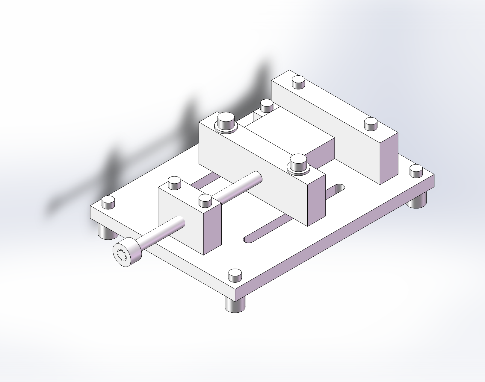
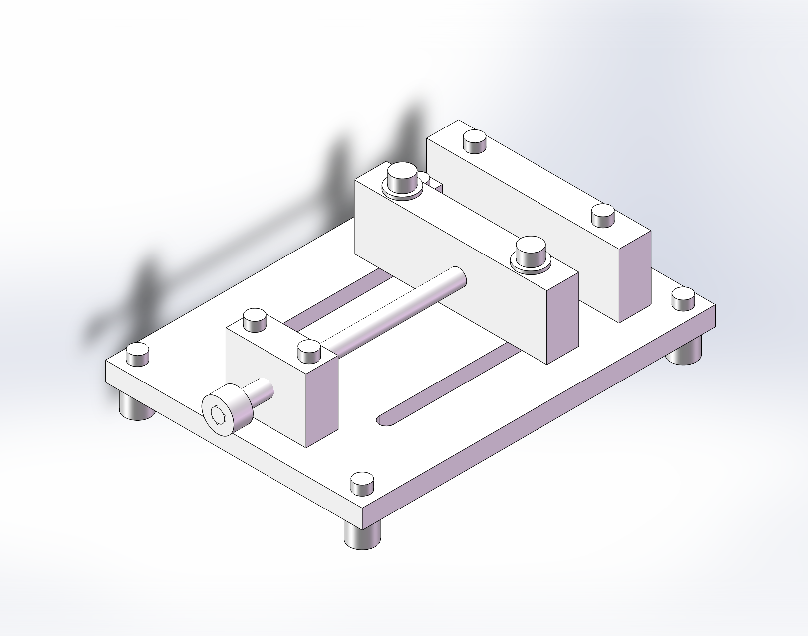
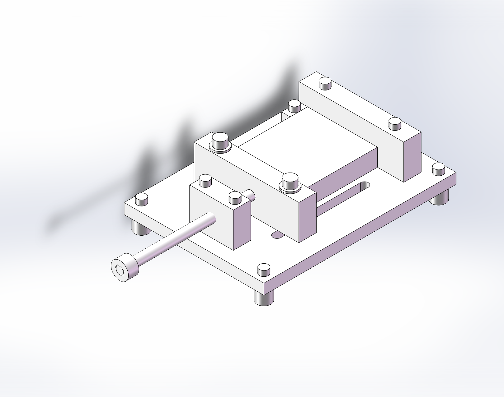

# AJF-01 可调定位夹具设计与软件验证

[作品集网页](https://shen111-6.github.io/ajf-01-adjustable-fixture/) · [完整交付包](https://github.com/shen111-6/ajf-01-adjustable-fixture/releases/tag/v1.0.0) · [验证报告](docs/verification-report.md) · [简历与面试](docs/resume-and-interview.md)



针对矩形工件的桌面尺寸检查与轻型装配定位需求，完成结构设计、SolidWorks原生建模与装配、AutoCAD标注图、BOM、理论计算和软件几何验证。AI辅助个人设计项目，交付边界为**设计与软件验证完成**；没有制造、实物试验、有限元或运动仿真。

## 可直接查看的成果

|内容|交付|
|---|---|
|主装配|29个实例、14种模型、28个有效锁定配合；旧旋钮配合保留为抑制记录|
|原生模型|16个SLDPRT：主装配14种，另有两种边界工件|
|开口检查|25/60/100mm三个实际静态装配；两端工件为25×20×10与100×80×20mm|
|二维图纸|6张DWG及DXF/SVG预览；22个AutoCAD原生尺寸对象|
|关联视图|6张SLDDRW，每张四个模型关联视图；详细标注以cad目录图纸为准|
|中性格式|主装配、边界装配及主要零件STEP|
|工程资料|需求、方案、公差意图、工艺、BOM、计算、风险和样机试验计划|
|搬移验收|Pack and Go重写引用，三个装配重开后全部引用解析自交付目录|

## 三个值得讲清楚的工程决定

1. **定位与夹紧分工**：A底板、B固定侧面、C端挡面分配六个自由度；丝杆靠紧，双M8锁紧活动夹爪。
2. **从检查中修订设计**：原95mm推杆不能覆盖小开口，改150mm；20mm开口与端挡块零间隙，改25mm；旋钮由仅端面接触改成12mm螺纹啮合。
3. **区分理论与实测**：400N假设下局部悬臂估算σ=12MPa、δ≈0.00311mm；未把该结果当作整套夹具精度。低摩擦时M6连接裕量仅1.0，保留为待实测/正向抗剪改进项。

## 开口边界检查

|25mm开口、最小工件|100mm开口、最大工件|
|---|---|
|||

三套装配各检测到11处重叠，均为攻丝底孔与简化螺纹外径的包络重叠；排除这些已解释的建模项后，没有其他实体穿透。不是“模型零干涉”。详细结果见[evidence](evidence)。

## 打开方式

下载Release交付包并完整解压。使用SolidWorks 2024或更新版打开：

- `solidworks/AJF01_Assembly.SLDASM`：60mm样例主装配。
- `solidworks/AJF01_L25.SLDASM` / `AJF01_L100.SLDASM`：边界装配。
- `cad/P01_Base.dwg`：底板标注图，AutoCAD 2018及更新版可打开。
- 没有SolidWorks时可查看STEP、网页和SVG图纸。

保留同目录零件，不单独移动装配文件。默认锁定配合是夹紧状态，不能拖动当运动仿真。原生模型的密度材质未统一赋值，BOM材料为设计选材，不提供软件默认质量作为制造指标。

## 验证与复查

查看[软件验证报告](docs/verification-report.md)。跨平台文件完整性检查：

```bash
python tools/check_delivery.py
```

该脚本与GitHub CI核对散列、文件数量、计算关系、链接和已记录证据的一致性；不会在Linux上运行商业CAD，也不替代实物测试。

## 完成边界

用于展示机械设计、二维制图、装配空间核对和工程验证思路。制造图中的材料、公差和粗糙度为设计意图；还未取得加工质量、重复定位和承载实测结果。不作为已批准生产或切削加工夹具使用。后续样机步骤保存在[试验计划](docs/prototype-test-plan.md)。
